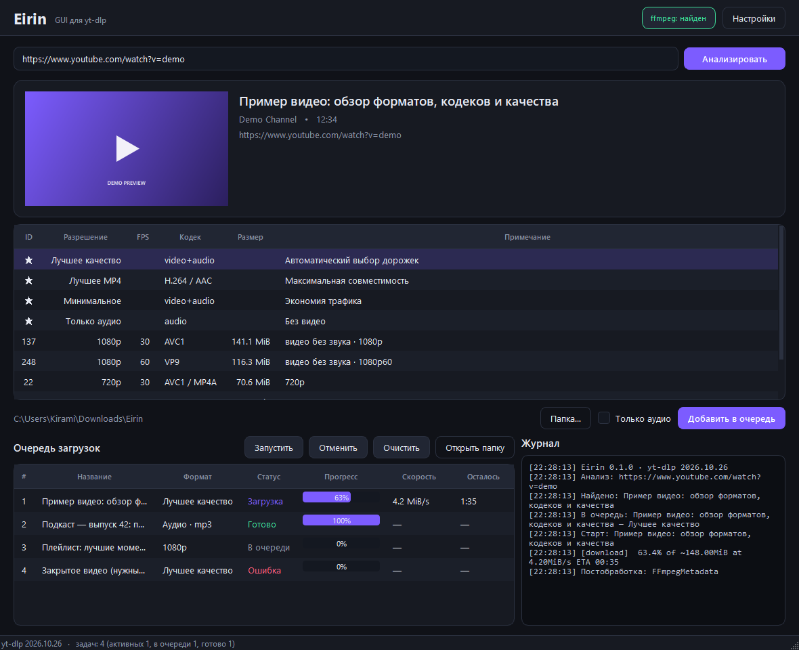

# Eirin

**Eirin** — настольная графическая оболочка для [yt-dlp](https://github.com/yt-dlp/yt-dlp)
на Python и PySide6. Вставляет ссылку, показывает доступные форматы и качает видео,
аудио и плейлисты в очередь.



## Возможности

- 🔎 **Анализ ссылки** — название, автор, длительность, обложка и список форматов
  без скачивания.
- 🎚 **Выбор формата** — готовые пресеты («Лучшее», «Лучшее MP4», «Только аудио»)
  или конкретная дорожка из таблицы. Для видео без звука аудиодорожка подставляется
  автоматически.
- 🎵 **Аудио** — извлечение в MP3, M4A, Opus, FLAC или WAV с настройкой качества.
- 📥 **Очередь** — несколько загрузок параллельно, прогресс, скорость, ETA,
  отмена и повторный запуск.
- 💬 **Журнал** — живой вывод yt-dlp прямо в окне.
- 🍪 **Cookies из браузера** — для видео, требующих авторизации.
- 🎬 **Постобработка** — встраивание обложки и метаданных, субтитры, SponsorBlock,
  перепаковка в MP4/MKV/WebM.
- 🌐 **Сеть** — прокси и ограничение скорости.
- 🌑 **Тёмная тема**, перетаскивание ссылок в окно, горячие клавиши.

## Требования

- Python **3.10+**
- [ffmpeg](https://ffmpeg.org/download.html) в `PATH` — нужен для объединения
  видео и звука, конвертации, субтитров и обложек. Без него приложение работает,
  но качает только готовые файлы источника.

## Установка и запуск

```powershell
git clone https://github.com/Kirami-i/Eirin-ytdlp-gui.git
cd Eirin-ytdlp-gui

python -m venv .venv
.\.venv\Scripts\Activate.ps1

pip install -e .
python -m eirin
```

Или через `pipx`:

```powershell
pipx install .
eirin
```

## Сборка в один .exe

```powershell
pip install pyinstaller
pyinstaller --noconfirm --windowed --name Eirin --collect-submodules yt_dlp run.py
```

Готовый файл появится в `dist\Eirin.exe`. Для работы по-прежнему нужен `ffmpeg`
в `PATH` (или положите `ffmpeg.exe` рядом с исполняемым файлом).

## Горячие клавиши

| Клавиши | Действие |
| --- | --- |
| `Enter` в поле ссылки | Анализировать |
| `Ctrl+Enter` | Добавить выбранный формат в очередь |
| `Ctrl+L` | Перейти к полю ссылки |
| `F5` | Запустить очередь |
| Двойной клик по задаче | Открыть файл или папку загрузок |

## Настройки

Настройки хранятся в `%APPDATA%\Eirin\settings.json` (Linux — `~/.config/Eirin`,
macOS — `~/Library/Application Support/Eirin`). Папка загрузок по умолчанию —
`~/Downloads/Eirin`.

## Структура проекта

```
eirin/
├── app.py                 # запуск QApplication
├── config.py              # модель настроек и JSON-хранилище
├── theme.py               # тёмная тема (QSS)
├── core/
│   ├── formats.py         # разбор форматов, форматирование размеров/времени
│   ├── jobs.py            # MediaInfo, DownloadJob
│   ├── options.py         # сборка параметров yt-dlp
│   ├── service.py         # QThread-воркеры анализа и скачивания
│   └── system.py          # проверка ffmpeg и версии yt-dlp
└── ui/
    ├── main_window.py     # главное окно и очередь
    ├── settings_dialog.py # диалог настроек
    └── widgets/           # карточка медиа, таблицы форматов и очереди
```

Ядро (`eirin/core/formats.py`, `options.py`, `config.py`) не зависит от PySide6,
поэтому покрыто обычными unit-тестами.

## Разработка

```powershell
pip install -e ".[dev]"
ruff check .
pytest
```

## Roadmap

- [ ] Планировщик и история загрузок
- [ ] Профили качества и собственные пресеты
- [ ] Обновление yt-dlp из интерфейса
- [ ] Скачивание каналов и фильтрация плейлистов
- [ ] Сворачивание в трей и уведомления
- [ ] Локализация (en)

## Лицензия

[MIT](LICENSE). Проект не связан с yt-dlp. Скачивайте только тот контент,
на который у вас есть право, и соблюдайте условия площадок.
